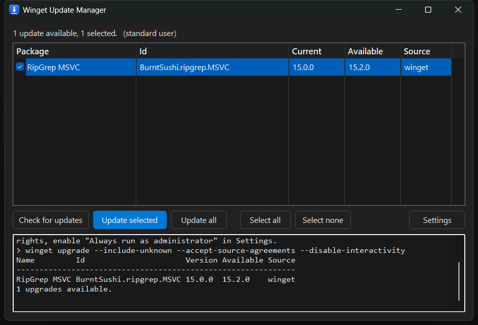
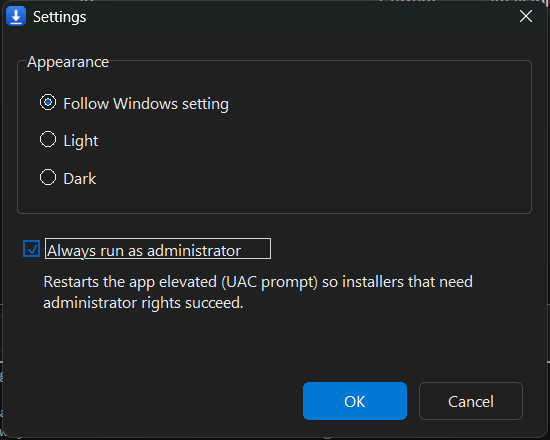
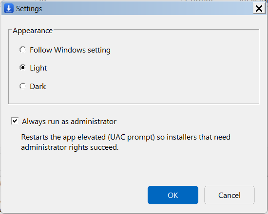

# Winget Update Manager

A tiny, portable Windows GUI for `winget` — a single `.exe`, no runtime, no
installer.


[](https://github.com/TaranUA/wingetGUI/releases/latest)
[](https://github.com/TaranUA/wingetGUI/actions/workflows/release.yml)



## Download

Grab `WingetGUI.exe` from the [latest release](https://github.com/TaranUA/wingetGUI/releases/latest) and run it.
There is nothing to install and no runtime to download.

> The executable is not code-signed, so SmartScreen may show *"Windows protected
> your PC"* the first time you run it. Choose **More info → Run anyway**.

## Features

- **Automatic check on launch** — the update list is populated as soon as the
  window opens.
- **Selectable list** — every available update is listed and checked by
  default; uncheck the ones you don't want.
- **Update selected** — upgrades only the checked packages, one `winget
  upgrade --id ... --exact` per item.
- **Update all** — runs `winget upgrade --all`.
- **Live log** — the raw `winget` output is shown in a terminal-style pane as
  it runs.
- **Modern interface** — Segoe UI typography, flat rounded buttons with
  hover/pressed feedback, an accent-highlighted primary action, rounded window
  corners and a roomy list with subtle row separators.
- **Follows the Windows theme** — light or dark, with a Settings dialog to
  override it (`System` / `Light` / `Dark`).
- **Optional elevation** — "Always run as administrator" relaunches the app
  elevated (UAC) so installers that need admin rights succeed.
- **Portable** — one statically linked file. No installation, no .NET, no
  Visual C++ redistributable.

## Usage

1. Double-click `WingetGUI.exe`.
2. The app checks for updates automatically and lists them (all checked).
3. Uncheck anything you don't want, then click **Update selected**, or click
   **Update all**.
4. Watch progress in the log pane; the list refreshes when the update finishes.

## Requirements

- Windows 10 or Windows 11.
- `winget` (App Installer) available on `PATH`. The app launches `winget.exe`
  directly and falls back to `cmd.exe /d /s /c` if needed.
- No runtime, framework, or installer. The `.exe` is statically linked.

## Settings

Settings are stored in an INI file. The app prefers a portable file next to the
executable (`WingetGUI.ini`) and falls back to
`%LOCALAPPDATA%\WingetGUI\settings.ini` when the program folder is read-only:

```ini
[ui]
theme=0          ; 0 = follow Windows, 1 = light, 2 = dark
run_as_admin=0   ; 1 = always relaunch elevated
```

| Dark | Light |
| --- | --- |
|  |  |

## Building

The build uses the portable [w64devkit](https://github.com/skeeto/w64devkit)
MinGW-w64 toolchain — no installation and no administrator rights required.
The toolchain is not committed to this repository.

1. Clone the repository:

   ```powershell
   git clone https://github.com/TaranUA/wingetGUI.git
   cd wingetGUI
   ```

2. Download `w64devkit` (v2.x) from the link above and extract it to
   `tools\w64devkit\` so that `tools\w64devkit\bin\g++.exe` and
   `tools\w64devkit\bin\windres.exe` exist.

3. Build:

   ```powershell
   powershell -ExecutionPolicy Bypass -File .\build.ps1
   ```

The result is `dist\WingetGUI.exe` (about 140 KB, statically linked).

Releases are built by GitHub Actions: pushing a `v*` tag runs
[`.github/workflows/release.yml`](.github/workflows/release.yml), which restores
the toolchain, runs the parser tests, builds, and attaches `WingetGUI.exe` to a
GitHub release.

> Close a running `WingetGUI.exe` before rebuilding — Windows locks the
> executable while it is running.

## Tests

The `winget` output parser has unit tests that need neither `winget` nor
administrator rights. They cover real captured `winget upgrade` output plus
generated edge cases (multi-byte names, missing `Source` column, repeated
tables, ANSI escapes):

```powershell
powershell -ExecutionPolicy Bypass -File .\tests\run_tests.ps1
```

`tests\theme_probe.cpp` is a small diagnostic for the dark/light colour values.

## Project layout

| Path | Purpose |
| --- | --- |
| `src\main.cpp` | Window, controls, layout, worker threads, log, Settings dialog |
| `src\parser.cpp` / `parser.h` | Parses `winget`'s fixed-width tables |
| `src\settings.cpp` / `settings.h` | INI load/save |
| `src\theme.cpp` / `theme.h` | Light/dark colours, DWM title bar, control theming |
| `src\strings.cpp` | Forces the used `std::string` / `std::wstring` members to be linked individually (see below) |
| `src\app.rc`, `resource.h`, `app.manifest`, `app.ico` | Resources, dialog, icon |
| `build.ps1` | Compiles resources and links the executable |
| `tests\` | Parser unit tests and a theme probe |
| `tools\make_icon.py` | Regenerates `src\app.ico` (Python 3, optional) |
| `tools\w64devkit\` | Local toolchain — downloaded, not committed |
| `docs\` | README screenshots |

Build output (`build\`, `dist\`) and local settings are ignored by Git.

## How it works

- `winget` has no machine-readable output, so the app parses its fixed-width
  table by deriving column offsets from the header row. Each row is decoded to
  UTF-16 before slicing so multi-byte package names don't shift the fields.
- `winget.exe` is launched with `CreateProcessW` and its output is streamed
  back to the GUI over `WM_APP` messages.
- Dark mode uses the undocumented `uxtheme.dll` entry points
  (`SetPreferredAppMode`, `AllowDarkModeForWindow`, `FlushMenuThemes`) plus
  `DwmSetWindowAttribute`. Because the classic common controls don't fully
  honour dark mode (and draw a focused radio/check label in black), the list
  header, push buttons, radio buttons, check boxes and group boxes are
  owner-drawn, and control colours are supplied through `WM_CTLCOLOR*`.

## Limitations

- Windows only, and `winget` must be installed.
- The parser depends on `winget`'s human-readable table layout. A future
  `winget` release that changes the columns may need a parser update — the unit
  tests make that easy to spot.
- Package and source agreements shown by `winget` are accepted automatically
  (`--accept-package-agreements`), matching the app's no-prompt behaviour.
  `winget` never pauses to display them.
- The binary is unsigned, so SmartScreen may warn on first launch.

## Keeping it small

The whole program is a single statically linked executable with no runtime
dependency. Size is kept down by:

- Optimising for size (`-Os`), compiling each function and data item into its
  own section and letting the linker garbage-collect everything that is not
  reachable (`--gc-sections`).
- Building without C++ exceptions and RTTI (`-fno-exceptions`, `-fno-rtti`),
  which neither the UI nor the parser uses.
- Disabling thread-safe local statics (`-fno-threadsafe-statics`): the only
  function-local static is the `uxtheme.dll` handle, which is loaded on the UI
  thread.
- Explicitly instantiating `std::string` and `std::wstring` in
  `src\strings.cpp`. libstdc++'s precompiled string objects put every member
  function in one section, so touching any of them pulls in the whole class;
  instantiating them in our own object lets the linker keep only the members
  that are actually used.
- Storing the icon as PNG frames instead of raw 32-bit bitmaps.

## Regenerating the icon (optional)

The icon is checked in at `src\app.ico`. It contains 16, 24, 32 and 48 px
frames compressed as PNG (about 2 KB total). To regenerate it you need Python 3:

```powershell
python .\tools\make_icon.py
```

## Contributing

Issues and pull requests are welcome. Please run the parser tests before
submitting a change:

```powershell
powershell -ExecutionPolicy Bypass -File .\tests\run_tests.ps1
```

## Changelog

### 1.0.1

**Fixed**

- Every yes/no prompt (for example the "Update all N packages now?"
  confirmation) displayed the exit dialog's three buttons because the
  message-box kind was classified twice, misreading the `MsgYesNo` enum as a
  flag mask.
- Native `MessageBoxW` dialogs stay partly light in dark mode no matter how
  they are themed, so prompts kept white strips (title bar edges, button
  faces). All prompts now use a custom, fully themed dialog instead — with
  DPI-aware layout and the text height measured to fit the message.
- The "Always run as administrator" checkbox could appear unchecked in
  Settings after an elevated relaunch: a stale, read-only `WingetGUI.ini`
  left next to the executable shadowed the settings saved to
  `%LOCALAPPDATA%`. A non-writable portable file is now ignored on load.
- The update-list parser could be confused by banner text that happens to
  contain the words `Name  Id  Version  Available`: a genuine header row is
  now required to be followed by the dash rule, so such lines no longer reset
  the column offsets and drop later rows (covered by a new unit test).
- A second click on an action button while an operation was already running
  silently did nothing; it now reports "Another operation is running" in the
  status bar.

**Changed**

- Settings are saved atomically (written to a temporary file, then swapped
  over the real one), so an interrupted save can no longer leave a
  half-updated INI behind.
- Accent colours (primary buttons, hover/pressed shades, list selection)
  now follow the user's Windows accent colour instead of a fixed blue, with
  the Windows 10 default blue as fallback.
- Layout, controls and list columns scale with the system DPI instead of
  assuming 96 DPI.
- Closing the window while an update runs can now really cancel it: every
  `winget` child process is grouped in a job object, so "cancel winget and
  close now" terminates the run, while "close and let it finish" releases it.
- The log pane trims whole leading lines once it passes ~2 MB, so a long
  `winget upgrade` cannot grow the edit control without bound.
- Cross-thread UI flags (`busy`, `alive`) are proper atomics instead of
  `volatile LONG`.

**Removed**

- Leftover `[dbg]` diagnostic lines from the startup log.

**Infrastructure**

- GitHub Actions: workflow actions updated to current major versions; the
  toolchain cache is saved only from the default branch, where tag builds
  can actually read it.

### 1.0.0

- Initial release.

## License

[MIT](LICENSE) © 2026 Taran
