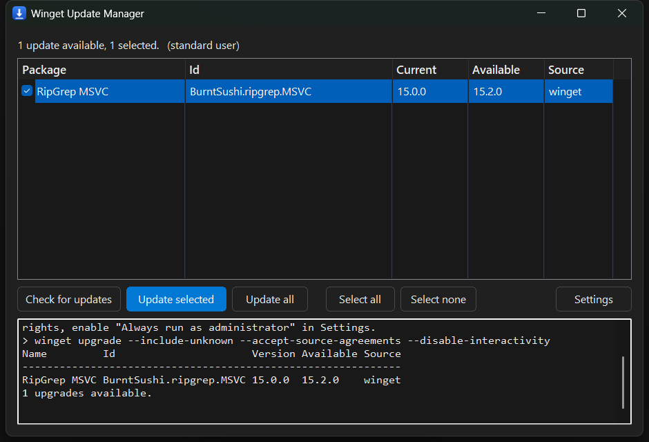
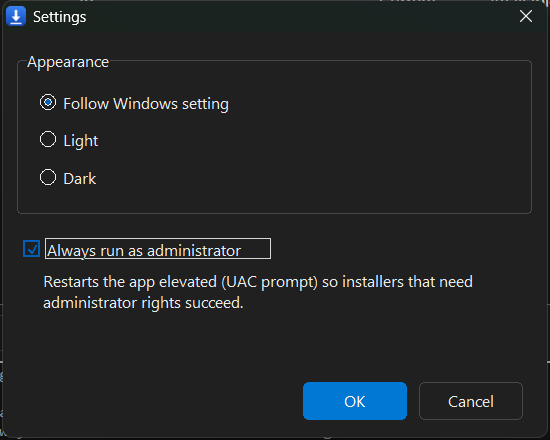
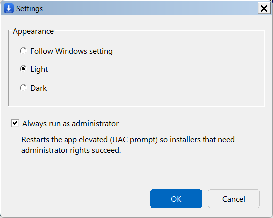

# Winget Update Manager

A tiny, portable Windows GUI for `winget` — a single `.exe`, no runtime, no
installer.


[](https://github.com/TaranUA/wingetGUI/releases/latest)
[](https://github.com/TaranUA/wingetGUI/actions/workflows/release.yml)



## Download

Grab `WingetGUI.exe` from the [latest release](https://github.com/TaranUA/wingetGUI/releases/latest) and run it.
There is nothing to install and no runtime to download.

> The executable is not code-signed, so SmartScreen may show *"Windows protected
> your PC"* the first time you run it. Choose **More info → Run anyway**.

## Features

- **Automatic check on launch** — the update list is populated as soon as the
  window opens.
- **Selectable list** — every available update is listed and checked by
  default; uncheck the ones you don't want.
- **Update selected** — upgrades only the checked packages, one `winget
  upgrade --id <id> --exact --include-unknown` per item.
- **Update all** — runs `winget upgrade --all --include-unknown`.
- **Live log** — the raw `winget` output is shown in a terminal-style pane as
  it runs.
- **Modern interface** — Segoe UI typography, flat rounded buttons with
  hover/pressed feedback, an accent-highlighted primary action, rounded window
  corners and a roomy list with subtle row separators.
- **Crisp on high-DPI and mixed-DPI setups** — the app is Per-Monitor V2 aware,
  so fonts, row heights, column widths and padding are rebuilt when the window
  is dragged between monitors with different scale factors.
- **Follows the Windows theme** — light or dark, with a Settings dialog to
  override it (`System` / `Light` / `Dark`).
- **Optional elevation** — "Always run as administrator" relaunches the app
  elevated (UAC) so installers that need admin rights succeed.
- **Portable** — one statically linked file. No installation, no .NET, no
  Visual C++ redistributable.

## Usage

1. Double-click `WingetGUI.exe`.
2. The app checks for updates automatically and lists them (all checked).
3. Uncheck anything you don't want, then click **Update selected**, or click
   **Update all**.
4. Watch progress in the log pane; the list refreshes when the update finishes.

## Requirements

- Windows 10 or Windows 11.
- Microsoft App Installer with WinGet registered for the current user.
- No runtime, framework, or installer. The `.exe` is statically linked.

## Settings

Settings are stored in `WingetGUI.ini` next to the executable. If that file
cannot be saved, the app uses `%LOCALAPPDATA%\WingetGUI\settings.ini`. Once
the LocalAppData file exists, it takes precedence on subsequent reads and writes.

```ini
[ui]
theme=0          ; 0 = follow Windows, 1 = light, 2 = dark
run_as_admin=0   ; 1 = always relaunch elevated
```

| Dark | Light |
| --- | --- |
|  |  |

## Building

The build uses the portable [w64devkit](https://github.com/skeeto/w64devkit)
MinGW-w64 toolchain — no installation and no administrator rights required.
The toolchain is not committed to this repository.

1. Clone the repository:

   ```powershell
   git clone https://github.com/TaranUA/wingetGUI.git
   cd wingetGUI
   ```

2. Download `w64devkit` (v2.x) from the link above and extract it to
   `tools\w64devkit\` so that `tools\w64devkit\bin\g++.exe` and
   `tools\w64devkit\bin\windres.exe` exist.

3. Build:

   ```powershell
   powershell -ExecutionPolicy Bypass -File .\build.ps1
   ```

The result is a statically linked `dist\WingetGUI.exe`.

Releases are built by GitHub Actions: pushing a version tag such as `v1.0.3` runs
[`.github/workflows/release.yml`](.github/workflows/release.yml), which restores
the toolchain, runs the regression tests, builds, and attaches `WingetGUI.exe` to a
GitHub release.

If Windows locks the output executable, the build reports the locked path and
preserves the existing binary. Close that instance and run the build again.

## Tests

The regression suite uses captured WinGet output and test child processes. It
covers Unicode table fields, argument quoting, failed update checks, process
cancellation and background completion, and settings fallback. It can run
without WinGet or administrator rights.

```powershell
powershell -ExecutionPolicy Bypass -File .\tests\run_tests.ps1
```

Run `.\tests\run_tests.ps1 -LiveWinget` to also launch registered WinGet and
check for available updates without installing them.

`tests\theme_probe.cpp` is a small diagnostic for the dark/light colour values.

## Project layout

| Path | Purpose |
| --- | --- |
| `src\main.cpp` | Window, controls, layout, worker threads, log, Settings dialog |
| `src\parser.cpp` / `parser.h` | Parses `winget`'s fixed-width tables |
| `src\settings.cpp` / `settings.h` | INI load/save |
| `src\theme.cpp` / `theme.h` | Light/dark colours, DWM title bar, control theming |
| `src\strings.cpp` | Forces the used `std::string` / `std::wstring` members to be linked individually (see below) |
| `src\app.rc`, `resource.h`, `app.manifest`, `app.ico` | Resources, dialog, icon |
| `build.ps1` | Compiles resources and links the executable |
| `tests\` | Parser and Win32 regression tests, plus a theme probe |
| `tools\make_icon.py` | Regenerates `src\app.ico` (Python 3, optional) |
| `tools\w64devkit\` | Local toolchain — downloaded, not committed |
| `docs\` | README screenshots |

Build output (`build\`, `dist\`) and local settings are ignored by Git.

## How it works

- The app parses the fixed-width `winget upgrade` table using display-column
  widths and requests English headings when the installed WinGet supports it.
- The app resolves `winget.exe` from the registered App Installer package and
  launches it directly with `CreateProcessW`. Selected updates use the ID and
  source reported by WinGet. The app streams output to the GUI and checks the
  command's exit code before replacing the list or reporting update results.
- Closing during an operation can cancel the current WinGet command or let it
  finish in the background. Remaining selected-package commands are discarded.
- The window is Per-Monitor V2 DPI aware: `WM_DPICHANGED` rebuilds the fonts,
  the list row height and the control layout for the monitor the window moved
  to, with `GetDpiForWindow` / `SystemParametersInfoForDpi` supplying the
  scaled metrics.
- Dark mode uses the undocumented `uxtheme.dll` entry points
  (`SetPreferredAppMode`, `AllowDarkModeForWindow`, `FlushMenuThemes`) plus
  `DwmSetWindowAttribute`. Because the classic common controls don't fully
  honour dark mode (and draw a focused radio/check label in black), the list
  header, push buttons, radio buttons, check boxes and group boxes are
  owner-drawn, and control colours are supplied through `WM_CTLCOLOR*`.

## Limitations

- Windows only, and WinGet must be available through Microsoft App Installer.
- The parser depends on `winget`'s human-readable table layout. A future
  `winget` release that changes the columns may need a parser update — the unit
  tests make that easy to spot.
- Package and source agreements shown by `winget` are accepted automatically
  (`--accept-package-agreements`), matching the app's no-prompt behaviour.
  `winget` never pauses to display them.
- The binary is unsigned, so SmartScreen may warn on first launch.

## Keeping it small

The whole program is a single statically linked executable with no runtime
dependency. Size is kept down by:

- Optimising for size (`-Os`), compiling each function and data item into its
  own section and letting the linker garbage-collect everything that is not
  reachable (`--gc-sections`).
- Building without C++ exceptions and RTTI (`-fno-exceptions`, `-fno-rtti`),
  and suppressing SEH unwind tables (`-fno-asynchronous-unwind-tables`,
  `-fno-unwind-tables`), which removes unused `.pdata` and `.xdata` sections (~24 KB).
- Disabling thread-safe local statics (`-fno-threadsafe-statics`): the only
  function-local static is the `uxtheme.dll` handle, which is loaded on the UI
  thread.
- Explicitly instantiating `std::string` and `std::wstring` and stubbing libstdc++'s
  `__throw_*` boundaries in `src\strings.cpp`. In libstdc++, exception-raising stubs
  drag in COW strings, `std::random_device`, `std::system_error` and the full exception
  machinery; stubbing them lets the linker discard all of it (~45 KB saved).
- Dropping the compiler identification strings (`-fno-ident`).
- Storing the icon as PNG frames instead of raw 32-bit bitmaps.

## Regenerating the icon (optional)

The icon is checked in at `src\app.ico`. It contains 16, 24, 32 and 48 px
frames compressed as PNG (about 2 KB total). To regenerate it you need Python 3:

```powershell
python .\tools\make_icon.py
```

## Contributing

Issues and pull requests are welcome. Please run the regression tests before
submitting a change:

```powershell
powershell -ExecutionPolicy Bypass -File .\tests\run_tests.ps1
```

## Changelog

### 1.0.3

**Added**

- **WinGet is located through App Installer.** `winget.exe` is resolved from
  the registered `Microsoft.DesktopAppInstaller` package
  (`FindPackagesByPackageFamily` → `GetPackagePathByFullName`) instead of
  relying on `PATH` and a `cmd.exe` fallback, so the app also works when the
  app-execution alias is missing or policy-restricted.
- **Exit-code-aware results.** Update checks validate WinGet's exit code and
  output: a failed check keeps the previous list and reports the
  `0x8A15xxxx` code, "no applicable update" (`0x8A15002B`, `0x8A150014`) clears
  it, and a successful exit with unreadable output is reported instead of
  showing an empty list. Selected-package runs now report per-package failures
  and skips with a summary.
- **English table headings.** When `winget upgrade --help` advertises
  `--output-locale`, the check asks for `en-US` so the fixed-width columns do
  not depend on the system language. Builds that reject the flag at runtime
  are retried without it.
- **Display-column parsing.** Column offsets are computed from ICU grapheme
  breaks and East Asian width (`ubrk_*`, `u_getIntPropertyValue`, with a
  `GetStringTypeW` fallback), so wide package names and ellipsized cells no
  longer shift the ID, version and source fields. Duplicate rows are collapsed
  per (id, source) instead of per id.
- **Runtime regression tests.** `tests\runtime_test.cpp` exercises the real
  Win32 helpers — child process capture, cancel versus release on shutdown,
  settings fallback, and check-result handling. `tests\run_tests.ps1` builds
  and runs it; `-LiveWinget` adds a read-only live check against the installed
  WinGet.

**Fixed**

- **Accent colour channels.** `DwmGetColorizationColor` returns `0xAARRGGBB`
  but was used as a `COLORREF`, which swapped red and blue. The value is now
  converted properly.
- **Settings fallback.** Once `%LOCALAPPDATA%\WingetGUI\settings.ini` exists it
  takes precedence for both reads and writes, so a portable INI that later
  becomes writable can no longer shadow newer settings. Saves are atomic on the
  destination volume, `Save()` returns a result, and the Settings dialog now
  reports a write failure instead of closing silently.
- **Background finishes and cancellation.** WinGet is started suspended,
  assigned to its job object, and only then resumed, so a close cannot race the
  assignment. After the window closes the output pipe is still drained until
  the current command exits; choosing "No" at the close prompt lets that
  command finish and discards the remaining selected-package commands.

**Changed**

- `build.ps1` no longer kills a running instance. It links to a unique staged
  file and replaces `dist\WingetGUI.exe` atomically, so a locked output keeps
  the previous binary and the error names the path to close.
- CI is split into a read-only build/test job and a publish job that runs only
  when a tag is present, with the tag validated against semver and the binary
  handed over through `download-artifact`.
- Settings paths use a 32K-character buffer, failed `PostMessage` calls free
  their payloads, and the worker thread is joined on exit.
- The suite now runs 64 parser checks plus 20 runtime checks.
- The executable grew from 79 KB (1.0.2) to 91 KB after adding the App
  Installer lookup and display-column parsing. ICU is loaded from Windows
  (`System32\icu.dll`) when present and is not bundled.

### 1.0.2

**Added**

- **Per-Monitor V2 DPI awareness.** The manifest declares `PerMonitorV2` and the
  window handles `WM_DPICHANGED`, rebuilding fonts, list row heights, column
  widths, button padding and control geometry for the monitor the window moved
  to. Text stays sharp instead of being bitmap-stretched, and the layout no
  longer overflows on high-scale displays.
- **Safe command-line quoting.** Package IDs are escaped before being handed to
  `winget` (standard `CommandLineToArgvW` rules), so an id containing quotes or
  other special characters can no longer break the command line. The tests
  parse the generated command line back with `CommandLineToArgvW` to prove the
  round trip.

**Changed**

- `build.ps1` terminates a running `WingetGUI.exe` before linking, so rebuilding
  no longer fails with `ld.exe: cannot open output file ... Permission denied`.
- The parser test suite grew to 57 checks.

**Smaller**

- `WingetGUI.exe` shrank from 148 KB (1.0.1) to 79 KB — about 46% — by
  suppressing SEH unwind tables (`-fno-asynchronous-unwind-tables`,
  `-fno-unwind-tables`, ~24 KB) and stubbing libstdc++'s `__throw_*` entry
  points, which lets the linker drop the exception runtime, COW strings,
  `std::random_device` and `std::system_error` (~45 KB).

### 1.0.1

**Fixed**

- Every yes/no prompt (for example the "Update all N packages now?"
  confirmation) displayed the exit dialog's three buttons because the
  message-box kind was classified twice, misreading the `MsgYesNo` enum as a
  flag mask.
- Native `MessageBoxW` dialogs stay partly light in dark mode no matter how
  they are themed, so prompts kept white strips (title bar edges, button
  faces). All prompts now use a custom, fully themed dialog instead — with
  DPI-aware layout and the text height measured to fit the message.
- The "Always run as administrator" checkbox could appear unchecked in
  Settings after an elevated relaunch: a stale, read-only `WingetGUI.ini`
  left next to the executable shadowed the settings saved to
  `%LOCALAPPDATA%`. A non-writable portable file is now ignored on load.
- The update-list parser could be confused by banner text that happens to
  contain the words `Name  Id  Version  Available`: a genuine header row is
  now required to be followed by the dash rule, so such lines no longer reset
  the column offsets and drop later rows (covered by a new unit test).
- A second click on an action button while an operation was already running
  silently did nothing; it now reports "Another operation is running" in the
  status bar.

**Changed**

- Settings are saved atomically (written to a temporary file, then swapped
  over the real one), so an interrupted save can no longer leave a
  half-updated INI behind.
- Accent colours (primary buttons, hover/pressed shades, list selection)
  now follow the user's Windows accent colour instead of a fixed blue, with
  the Windows 10 default blue as fallback.
- Layout, controls and list columns scale with the system DPI instead of
  assuming 96 DPI.
- Closing the window while an update runs can now really cancel it: every
  `winget` child process is grouped in a job object, so "cancel winget and
  close now" terminates the run, while "close and let it finish" releases it.
- The log pane trims whole leading lines once it passes ~2 MB, so a long
  `winget upgrade` cannot grow the edit control without bound.
- Cross-thread UI flags (`busy`, `alive`) are proper atomics instead of
  `volatile LONG`.

**Removed**

- Leftover `[dbg]` diagnostic lines from the startup log.

**Infrastructure**

- GitHub Actions: workflow actions updated to current major versions; the
  toolchain cache is saved only from the default branch, where tag builds
  can actually read it.

### 1.0.0

- Initial release.

## License

[MIT](LICENSE) © 2026 Taran
